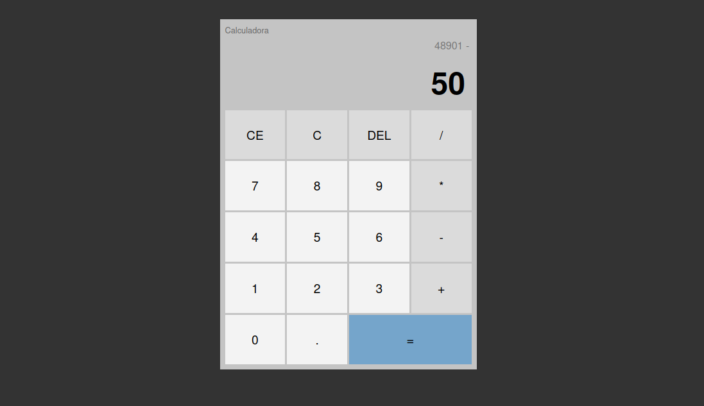

# Calculadora JS

Uma calculadora desenvolvida com HTML, CSS e JavaScript puro. O projeto foi criado como exercício prático para consolidar os conhecimentos adquiridos no curso **JavaScript do básico ao avançado**, de Matheus Battisti, aplicando conceitos de manipulação do DOM, eventos, classes, métodos, condicionais e operações matemáticas.


## Como funciona

A interface apresenta um visor dividido em duas partes:

- **Operação anterior:** exibe o valor calculado e o operador selecionado.
- **Operação atual:** exibe os números que estão sendo digitados.

Os botões da calculadora são identificados pelo texto exibido e tratados por um único listener de evento. A lógica da aplicação fica concentrada na classe `Calculator`, que recebe as referências dos elementos do DOM e controla o estado da operação.

### Operações disponíveis

- `+`: soma.
- `-`: subtração.
- `*`: multiplicação.
- `/`: divisão.
- `=`: executa a operação selecionada.
- `DEL`: remove o último caractere da operação atual.
- `CE`: limpa somente a operação atual.
- `C`: limpa a operação anterior e a operação atual.
- `.`: permite inserir números decimais, evitando mais de um ponto na mesma operação.

## Como executar

O projeto não possui dependências externas, `package.json` ou etapa de compilação.

### Pelo navegador

1. Clone o repositório:

   ```bash
   git clone https://github.com/KaykeNicolas007/calculadora-js.git
   ```

2. Entre na pasta do projeto:

   ```bash
   cd calculadora-js
   ```

3. Abra o arquivo `index.html` no navegador.

Também é possível utilizar a extensão **Live Server** do VS Code para abrir a aplicação com recarregamento automático durante o desenvolvimento.

## Exemplo de uso

Para calcular `12 + 8`:

1. Clique em `1` e `2`.
2. Clique em `+`.
3. Clique em `8`.
4. Clique em `=`.

O resultado da operação é usado como base para a próxima operação exibida no visor.

## Estrutura do código

```text
calculadora-js/
├── index.html       # Estrutura da página e botões da calculadora
├── css/
│   └── styles.css   # Estilos, layout e aparência da interface
├── js/
│   └── scripts.js   # Estado, eventos e regras da calculadora
├── LICENSE          # Licença do projeto
└── README.md        # Documentação
```

### `index.html`

Define a estrutura da aplicação, incluindo:

- o contêiner principal da calculadora;
- os visores da operação anterior e atual;
- os botões numéricos, operadores e comandos;
- o carregamento dos arquivos de estilo e JavaScript.

O script é carregado com `defer`, garantindo que o HTML seja processado antes da execução do JavaScript.

### `css/styles.css`

Controla a apresentação visual da calculadora. Entre os recursos utilizados estão:

- Flexbox para centralizar a calculadora na página;
- CSS Grid para organizar os botões em quatro colunas;
- estilos diferentes para números, operadores e o botão de igualdade;
- estados `:hover` para indicar interação;
- `overflow-wrap` para evitar que operações longas ultrapassem o visor.

### `js/scripts.js`

Implementa a lógica principal por meio da classe `Calculator`:

- `addDigit()`: adiciona números e pontos ao visor;
- `updateScreen()`: atualiza o visor atual ou registra o resultado e o operador;
- `processOperation()`: direciona cada operador para sua ação;
- `changeOperation()`: permite trocar o operador antes de informar o próximo número;
- `processDelOperator()`: remove o último caractere;
- `processClearOperationOperator()`: limpa a operação atual;
- `processClearAllOperation()`: limpa os dois visores;
- `processEqualOperation()`: repete a operação armazenada ao pressionar `=`.

No final do arquivo, os elementos da interface são obtidos com `querySelector` e cada botão recebe um `click` listener. O valor do botão é encaminhado para `addDigit()` quando for um número ou ponto; caso contrário, é encaminhado para `processOperation()`.

## Conhecimentos desenvolvidos

- **JavaScript:** variáveis, métodos, classes, construtor, `this`, condicionais, `switch`, operadores matemáticos e valores padrão de parâmetros.
- **Programação orientada a objetos:** organização do comportamento da calculadora na classe `Calculator`.
- **DOM:** seleção de elementos com `querySelector` e `querySelectorAll`, além da atualização de `innerText`.
- **Eventos:** uso de `addEventListener` para responder aos cliques dos botões.
- **Arrays e métodos:** uso de `includes` para validação de operadores e ponto decimal.
- **Manipulação de strings:** uso de `split`, `slice` e concatenação para controlar os valores exibidos.
- **HTML semântico de interface:** estruturação de controles com elementos `button`.
- **CSS:** Flexbox, Grid, seletores, pseudo-classes e organização visual de componentes.
- **Git e GitHub:** uso básico das ferramentas de versionamento e colaboração, comuns no mercado.

## Limitações conhecidas

- A calculadora funciona somente por meio de cliques; não há suporte para teclado.
- Não existe tratamento específico para divisão por zero, que pode resultar em `Infinity` ou `NaN`.
- O ponto decimal é validado apenas em relação ao conteúdo atual do visor.
- Não há validação avançada para entradas como ponto no início, múltiplos operadores ou números negativos digitados diretamente.
- O resultado é mantido na área da operação anterior para continuar o fluxo da calculadora, em vez de possuir um visor de resultado separado.
- Não há testes automatizados nem configuração de lint ou formatação.
- A interface não possui recursos específicos de acessibilidade, como rótulos adicionais, navegação documentada por teclado ou feedback para leitores de tela.

## Ideias de evolução

- Adicionar suporte à entrada por teclado e atalhos para `Enter`, `Backspace` e `Escape`.
- Tratar divisão por zero e entradas inválidas com mensagens claras para o usuário.
- Melhorar o suporte a números negativos, operações encadeadas e precedência matemática.
- Criar testes automatizados para os métodos da classe `Calculator`.
- Separar o cálculo da atualização da interface para facilitar manutenção e testes.
- Adicionar acessibilidade aos botões e aos visores com atributos e feedback apropriados.
- Tornar o layout responsivo para telas menores.
- Adicionar histórico de operações.
- Permitir copiar o resultado e alternar entre temas claro e escuro.
